<div align="center">

# 🏥 HealSmart — Hospital Management System

**A full-stack web platform that connects every hospital department (patients, doctors, labs, finance, and support) in one system.**


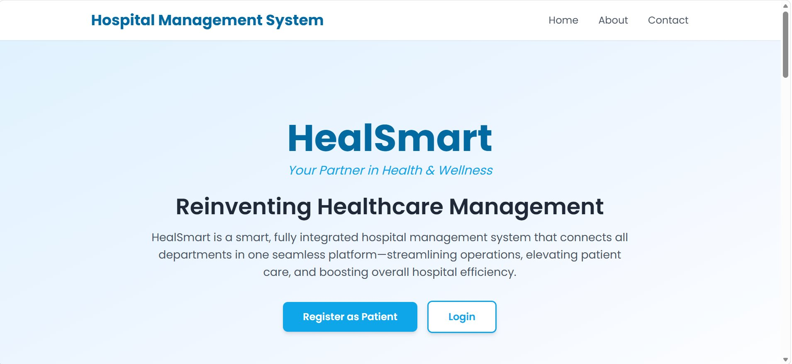

</div>

---

## Overview

Hospitals often run their departments on separate systems: one for booking, another for lab results, and another for billing. **HealSmart** brings all of them into one platform. Each user role gets its own dashboard, and every action is stored in a shared **Oracle database**. When a doctor requests a lab test, it immediately appears for the lab technician, and the result then shows up in the patient's portal.

The system was built as a **team project** for a software development course, using the **Agile Scrum** methodology.

## Features by role

| Role | What they can do |
|---|---|
| 🧑 **Patient** | Register, book appointments by department, doctor, date, and time; pay with an insurance discount; view appointments, medical records, and lab results; chat with customer service |
| 👨‍⚕️ **Doctor** | View and filter appointments, mark them complete, add medical records, request lab tests, and track their status |
| 🧪 **Lab Technician** | View all lab requests by status (pending, in progress, completed) and upload results |
| 🛡️ **Hospital Manager (Admin)** | Manage staff, add or remove staff accounts, and manage supported insurance providers |
| 💰 **Accountant** | Revenue and payment statistics, a full transaction log, and CSV export |
| 💬 **Customer Service** | Handle live patient conversations and mark them as resolved |
| 📣 **Marketing** | Compose promotional email campaigns for targeted patient groups (UI only) |

## Screenshots

| Hospital manager: staff | Doctor: appointments |
|---|---|
| 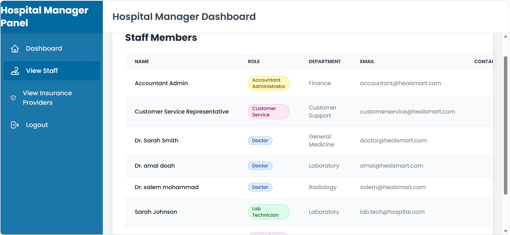 | 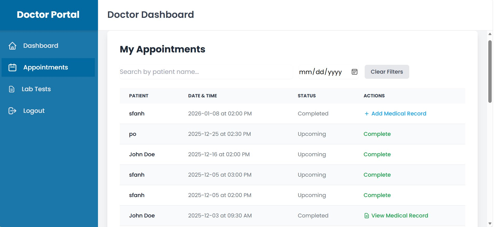 |

| Doctor: lab requests | Lab technician dashboard |
|---|---|
| 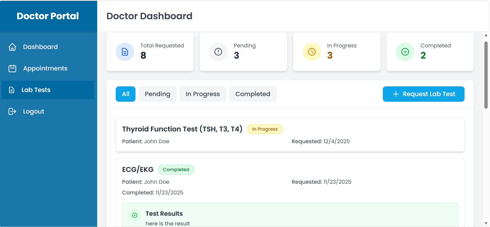 | 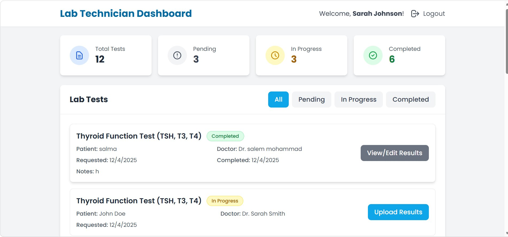 |

| Patient: book appointment | Payment with insurance discount |
|---|---|
| 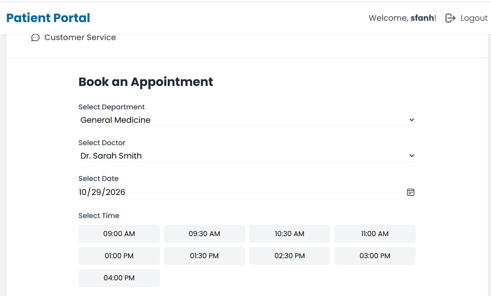 | 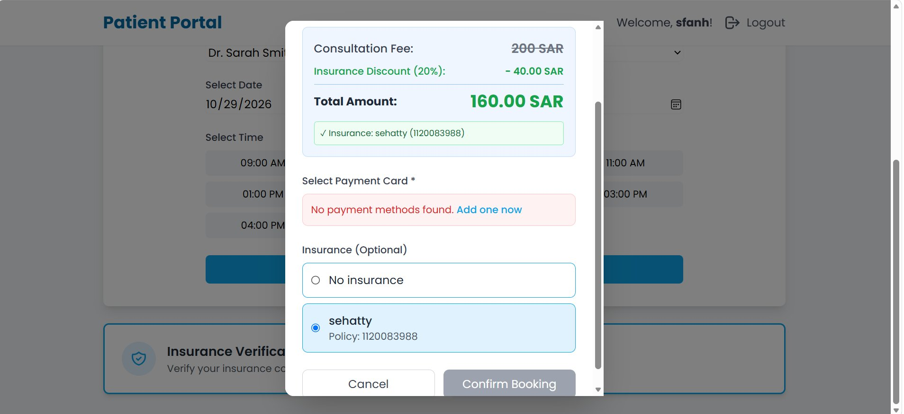 |

| Patient: my appointments | Customer service chat |
|---|---|
| 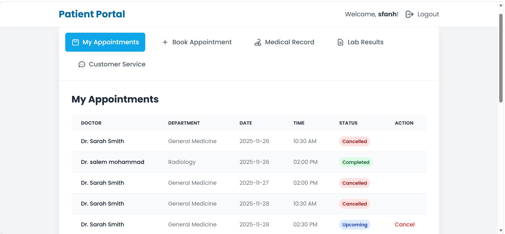 | 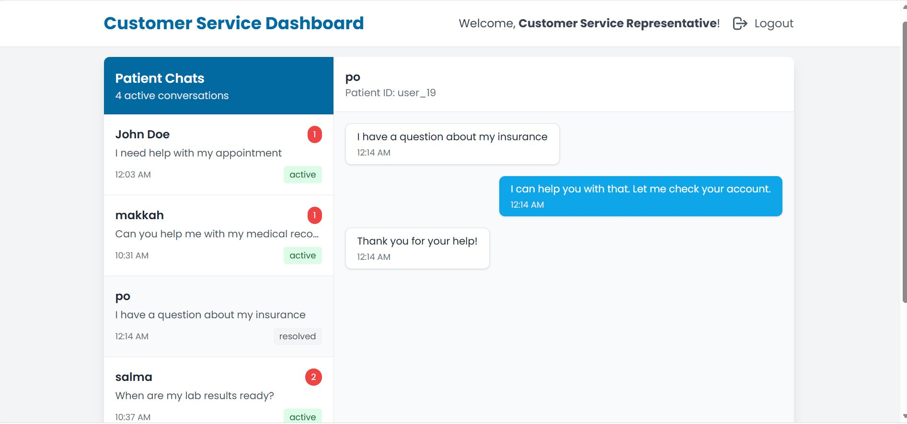 |

| Accountant dashboard | Marketing campaigns |
|---|---|
| 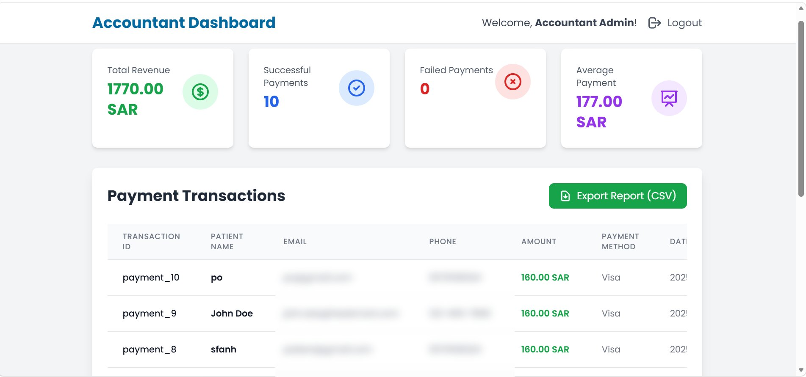 | 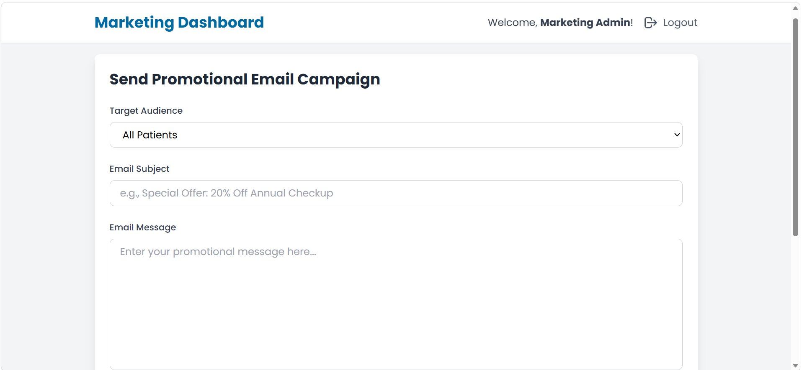 |

## Architecture

```
React + TypeScript (Vite)  ──HTTP/JSON──►  Express REST API  ──oracledb──►  Oracle Database
   role-based dashboards                    /api/auth, /api/appointments,       7 related tables
                                            /api/lab-tests, /api/payments …     sequences + indexes
```

### Database design

The Oracle schema ([`src/database/schema.sql`](src/database/schema.sql)) has **7 related tables**: `Users`, `Appointments`, `Medical_Records`, `Lab_Tests`, `Prescriptions`, `Insurance`, and `Payments`. It also has **8 sequences** for auto-increment IDs and **22 indexes** to speed up the most common queries, such as looking up appointments by doctor or patient, or lab tests by status.

## Run it locally

**Requirements:** Node.js 20+ and Oracle Database 21c XE.

```bash
git clone https://github.com/bushrall0/hospital-management-system.git
cd hospital-management-system
npm install

cp .env.example .env     # then fill in your Oracle user, password and connection string
npm run db:init          # creates the tables and loads sample data
npm run dev:all          # starts the API (port 5000) and the frontend (port 3000)
```

Open http://localhost:3000. Sample accounts are created by [`src/database/seed.sql`](src/database/seed.sql). For example, the admin account is `admin@healsmart.com` / `Admin@12345`.

See [`DATABASE_SETUP.md`](DATABASE_SETUP.md) for a step-by-step Oracle setup guide.

## Project structure

```
hospital-management-system/
├── server/index.ts        # Express REST API
├── src/
│   ├── pages/             # Dashboards per role (patient, doctor, admin, labTechnician, accountant, …)
│   ├── components/        # Shared UI components
│   ├── services/          # Data access per entity (users, appointments, lab tests, payments, …)
│   ├── database/          # Oracle connection pool, schema.sql, seed.sql, migrations
│   └── api/client.ts      # Frontend API client
└── docs/screenshots/
```

## Team & my role

This was a team project built with Agile Scrum.

**Bushra Almughirah: UI/UX design & database design**
- Designed the user interface and user experience of the role-based dashboards
- Designed the Oracle database: tables, relationships, sequences, indexes, and sample data

> This is an educational project. Passwords are stored in plain text for demo purposes only, so do not use real credentials.
